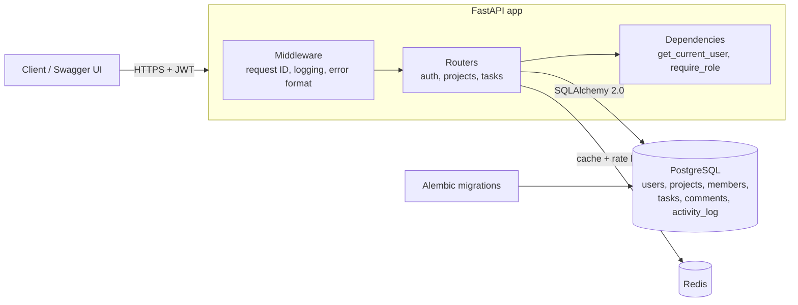
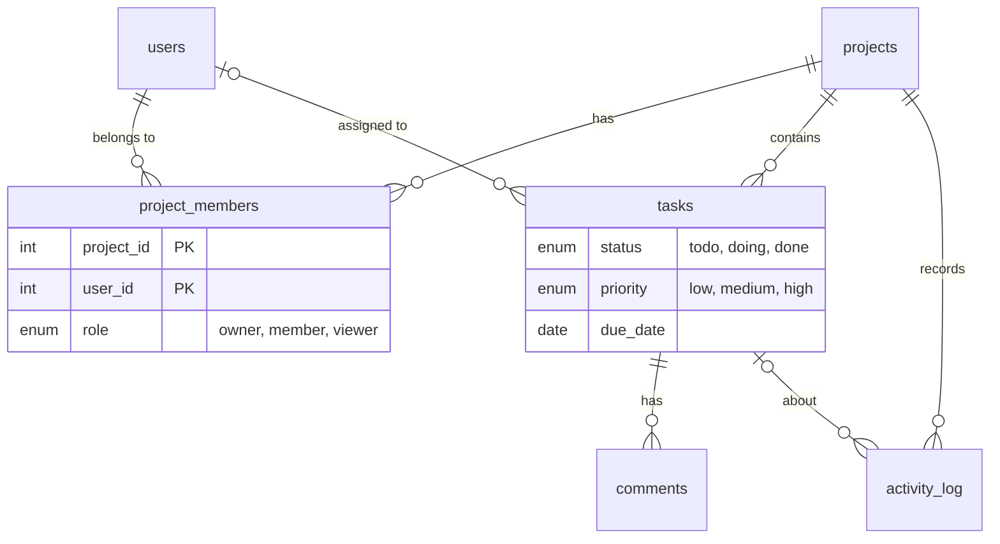

# Task Board API

A REST API for team task boards: projects with role-based membership, tasks with status, priority, assignee and due date, comments, and an activity log of every change.

Built with **FastAPI**, **PostgreSQL** (SQLAlchemy 2.0 + Alembic), **Redis** and **JWT** auth. 20 endpoints, 20 integration tests against real Postgres and Redis, ~99% coverage, type-checked with mypy.

## Quickstart

```bash
docker compose up --build
docker compose exec api python -m app.seed   # optional demo data
```

- API: http://localhost:8000
- Interactive docs (Swagger UI): http://localhost:8000/docs
- Demo login after seeding: `demo@example.com` / `password123` (owner) or `viewer@example.com` / `password123` (read-only)

## Architecture



**Data model**



## Endpoints

All endpoints except register, login and health need `Authorization: Bearer <token>`.

| Method | Path | Min. role | Description |
|---|---|---|---|
| POST | `/auth/register` | – | Create an account |
| POST | `/auth/login` | – | Get a JWT (OAuth2 password form, rate-limited per IP) |
| GET | `/auth/me` | – | Current user |
| POST | `/projects` | – | Create a project (you become owner) |
| GET | `/projects` | – | Projects you belong to, with your role |
| GET | `/projects/{id}` | viewer | Project details |
| PATCH | `/projects/{id}` | owner | Rename / edit description |
| DELETE | `/projects/{id}` | owner | Delete project and everything in it |
| GET | `/projects/{id}/members` | viewer | List members |
| POST | `/projects/{id}/members` | owner | Add a member by email with a role |
| DELETE | `/projects/{id}/members/{user_id}` | owner | Remove a member (not the last owner) |
| GET | `/projects/{id}/activity` | viewer | Activity log, newest first |
| POST | `/projects/{id}/tasks` | member | Create a task |
| GET | `/projects/{id}/tasks` | viewer | List tasks: filter, sort, paginate (cached) |
| GET | `/projects/{id}/tasks/{task_id}` | viewer | Task details |
| PATCH | `/projects/{id}/tasks/{task_id}` | member | Update a task (each change is logged) |
| DELETE | `/projects/{id}/tasks/{task_id}` | member | Delete a task |
| GET | `/projects/{id}/tasks/{task_id}/comments` | viewer | List comments |
| POST | `/projects/{id}/tasks/{task_id}/comments` | member | Add a comment |
| GET | `/health` | – | Checks Postgres and Redis, 503 if either is down |

**Task list query parameters:** `status`, `priority`, `assignee_id`, `due_before`, `q` (title search), `sort` (`created_at`, `due_date`, `priority`, `title`, prefix `-` for descending), `limit` (1–100), `offset`.

```
GET /projects/1/tasks?status=todo&sort=-priority&limit=10
→ {"items": [...], "total": 3, "limit": 10, "offset": 0}
```

**Errors** always have the same shape, and every response carries an `X-Request-ID` header (yours is reused if you send one):

```json
{"error": {"status": 404, "message": "Project not found"}, "request_id": "3f9c..."}
```

## Swagger walkthrough

1. `docker compose up --build`, then `docker compose exec api python -m app.seed`.
2. Open http://localhost:8000/docs and click **Authorize**. Enter `demo@example.com` / `password123` (leave client id/secret empty).
3. `GET /projects` → the seeded "Website relaunch" project with `"role": "owner"`.
4. `GET /projects/1/tasks` with `sort=-priority` → tasks ordered high → low.
5. `PATCH /projects/1/tasks/3` with `{"status": "doing"}`, then `GET /projects/1/activity` → `"status changed from todo to doing"`.
6. Log out, authorize as `viewer@example.com` and try the same PATCH → `403`. Try `GET /projects/2` → `404`.

## Design decisions

- **One permission dependency.** `require_role(min_role)` loads the caller's membership for `project_id` and is used as `Depends(can_view | can_edit | is_owner)`. Non-members get **404** rather than 403 so project ids don't leak; members with too low a role get **403**.
- **Filtering, sorting and pagination happen in SQL.** The sort field is a whitelist (`Literal`), so user input never reaches `ORDER BY` directly; title search escapes `%` and `_`. Priority sorts correctly because Postgres orders native enums by declaration order.
- **Cache invalidation by version key.** Cached task-list pages are keyed `tasks:{project}:v{n}:{params}`. Any task write increments `n`, which invalidates every cached page for that project in one `INCR`, with no key scanning. Pages also expire after 5 minutes.
- **Redis fails open.** If Redis is down, reads fall through to Postgres and login rate limiting is skipped; `/health` reports `degraded` (503). Redis is an optimisation, not a dependency for correctness.
- **Activity log survives deletes.** `activity_log.task_id` is `ON DELETE SET NULL`, so "deleted task 'X'" stays in the project history.
- **Sync SQLAlchemy.** FastAPI runs sync endpoints in a thread pool. That's enough for this workload and keeps the code and tests simple; async would be the next step under high concurrency.
- **argon2** for password hashing (current OWASP recommendation), short-lived HS256 JWTs.

## Development

```bash
python -m venv .venv && .venv/Scripts/activate   # or source .venv/bin/activate
pip install -r requirements-dev.txt
docker compose up -d db redis                     # tests use the taskboard_test database

ruff check . && ruff format --check .             # lint
mypy app tests                                    # type-check
pytest                                            # tests + coverage (fails under 80%)
alembic upgrade head                              # apply migrations to the dev database
```

CI (GitHub Actions) runs lint, type-check, a migration round-trip (`upgrade` → `check` → `downgrade`) and the test suite against Postgres and Redis service containers on every push and pull request.

## Project layout

```
app/
  main.py         app, middleware, error handlers, /health
  deps.py         get_current_user, require_role
  cache.py        Redis task-list cache and login rate limiter
  models.py       SQLAlchemy models
  schemas.py      Pydantic request/response models
  security.py     argon2 hashing, JWT
  seed.py         demo data
  routers/        auth, projects (+members, activity), tasks (+comments)
alembic/          migrations
tests/            pytest integration tests
```
